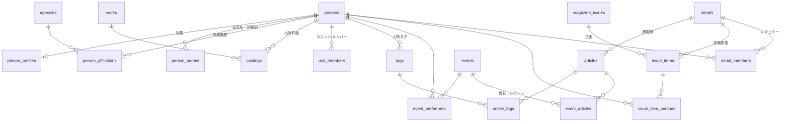

# seigura.com 人物中心データベース（PostgreSQL）

名鑑とタグを **同じ人物ID（`persons.person_id`）** で統一し、個人ページに
**関連記事・出演イベント・掲載号・連載** を自動で並べるためのスキーマです。

| ファイル | 内容 |
|---|---|
| [sql/01_schema.sql](sql/01_schema.sql) | テーブル・制約・インデックス |
| [sql/02_views.sql](sql/02_views.sql) | 個人ページ用ビュー、`person_page()`、`merge_person()`、移行チェック用ビュー |
| [sql/03_sample_data.sql](sql/03_sample_data.sql) | 架空の人物・記事によるサンプル |
| [sql/04_queries.sql](sql/04_queries.sql) | 個人ページ・タグページ・名鑑・移行作業でよく使うクエリ |
| [migrate/extract_wp.py](migrate/extract_wp.py) | WordPress（MySQL）から必要な行だけを TSV に書き出す（SELECT のみ） |
| [migrate/load_staging.sql](migrate/load_staging.sql) | TSV を作業用スキーマ `wp` に読み込む（psql） |
| [migrate/10_setup.sql](migrate/10_setup.sql) | 移行用の作業スキーマ・設定・対応表・補助関数（最初に1回） |
| [migrate/20_run.sql](migrate/20_run.sql) | 変換本体 `wp_migration.run()` と `apply_issue_candidates()` |
| [verify/verify.mjs](verify/verify.mjs) | PGlite（WASM 版 PostgreSQL）で全 SQL を流して 32 項目を検証 |
| [verify/verify_migration.mjs](verify/verify_migration.mjs) | WordPress を模した DB から移行を通しで実行して 25 項目を検証 |

PostgreSQL 15 以上が必要です。DB のタイムゾーンは `Asia/Tokyo` にしてください（`ALTER DATABASE … SET timezone = 'Asia/Tokyo'`）。

```bash
psql -d seigura -f sql/01_schema.sql -f sql/02_views.sql
```

---

## 1. 考え方

現在のサイトでは、名鑑は `/directory/5996/`（数値ID）、タグは `/tag/trysail/`（スラッグ）で、両者の間に紐付けがありません。
このスキーマでは **人物を1つのマスタ（`persons`）にまとめ、名鑑もタグもそこを参照** します。

```
                  ┌──────────── persons（person_id = 名鑑ID）────────────┐
                  │                                                      │
   名鑑 person_profiles / person_affiliations / castings                 │
                  │                                                      │
   tags.person_id ─┴─ article_tags ─ articles        → 関連記事（タグを付けるだけ）
   event_performers ─ events                         → 出演イベント（役割: 出演/MC/ゲスト）
   issue_item_persons ─ issue_items ─ magazine_issues → 掲載号（表紙/巻頭/グラビア…）
   serial_members ─ serials  ＋ 連載回へのタグ付け    → 連載（レギュラー/ゲスト）
```

- **記事は「人物タグ」経由で紐付ける。** タグ自体が `person_id` を持つので、編集者は今までどおりタグを付けるだけで個人ページに記事が出ます。
- **1人に複数のタグを持てる。** 旧芸名タグや表記ゆれタグも同じ `person_id` を指し、代表タグ（`is_primary`）は1人1つまでです。過去記事を付け直す必要はありません。
- **イベント・掲載号・連載は役割付きの中間テーブル。** MC・表紙・執筆といった役割はタグでは表せないため、`person_id` を直接持たせています。CMS の入力 UI は人物タグと同じピッカーを使い、保存時に `person_id` に変換すれば編集の手間は増えません。
- **既存IDを主キーにそのまま使う。** `person_id` = 名鑑ID、`tag_id` = WordPress term_id、`article_id` = WordPress post ID とすれば、URL もリダイレクトも変えずに済みます（IDENTITY は `BY DEFAULT` なので明示的に値を入れられます）。

## 2. テーブル



| 区分 | テーブル | 要点 |
|---|---|---|
| 人物 | `persons` | 個人もユニットも同じ表（`person_type`）。`kana_row`（あ/か/さ…）を自動計算。重複は `merged_into` で統合先を指す |
| | `person_names` | 旧芸名・別名・別表記。検索とタグ紐付け候補の抽出に使う |
| | `unit_members` | 在籍期間つき。複合外部キーで「ユニット ← 個人」以外の登録を防ぐ |
| 名鑑 | `person_profiles` | 1人1行。生年は非公表なら NULL（月日だけでも登録できる） |
| | `agencies` / `person_affiliations` | 所属履歴。現所属（`ended_on IS NULL`）は1人1件まで |
| | `works` / `castings` | 出演作品と役名。`is_main` は代表作 |
| タグ | `tags` | `tag_type` は person / work / topic。person なら `person_id` が必須（CHECK 制約） |
| 記事 | `articles` / `article_tags` | `status` と `published_at` で公開判定。連載回なら `serial_id` と `episode_no` |
| イベント | `events` / `event_performers` / `event_articles` | 出演キャンセルは `appearance = 'cancelled'` |
| 雑誌 | `magazine_issues` / `issue_items` / `issue_item_persons` | 号 → 企画（表紙・巻頭特集・グラビア・連載ページ…）→ 人物 |
| 連載 | `serials` / `serial_members` | Web・誌面・両方。ゲストは自動判定するので登録不要 |

## 3. 個人ページに自動で出るもの

`SELECT person_page(1001);` を実行すると、個人ページ1枚分の JSON がまとめて返ります（各セクションは最新20件。第2引数で件数を変更できます）。
セクションごとのビューを直接使うこともできます。

| セクション | ビュー | 表示される条件 |
|---|---|---|
| 関連記事 | `v_person_articles` | 本人のタグ（代表タグ・旧芸名タグ）が付いた公開済みの記事。下書きや公開前の予約投稿は出ない |
| 出演イベント | `v_person_events` | `event_performers` に登録があるもの。`is_upcoming` で今後と過去に分かれ、出演キャンセルは除外 |
| 掲載号 | `v_person_issues` | 企画に掲載された号。号ごとに「表紙・巻頭特集・連載」のようにまとめる |
| 連載 | `v_person_serials` | レギュラーとして登録された連載に加え、**連載回の記事に人物タグが付いていればゲストとして自動で表示**。誌面の連載ページに載った場合も同じ |

**ユニットの扱い:** ユニット（例: TrySail）に紐付いた記事・イベント・掲載号・連載は、メンバーの個人ページにも **在籍していた期間のものだけ** 表示されます。それぞれの項目には `via_unit_name`（「ソラノートとして」）が付きます。加入前や卒業後の活動は出ません。

**逆方向:** 記事ページの「この記事に登場する声優」は `v_article_persons` で取得できます。

`person_page()` の出力例（サンプルの 1003「森野 くるみ」、抜粋）:

```json
{
  "person_id": 1003, "name": "森野 くるみ", "agency": {"name": "スタジオ青嵐"},
  "articles": [
    {"title": "【ライブレポート】ソラノート 2nd LIVE「そらいろ」", "via_unit_name": "ソラノート"},
    {"title": "ひよりの陽だまり日記 第2回 ゲスト：森野くるみ", "via_unit_name": null}
  ],
  "issues": [{"issue_label": "2026年12月号", "items": [{"label": "グラビア"}, {"label": "インタビュー", "via_unit_name": "ソラノート"}, {"label": "連載"}]}],
  "serials": [
    {"title": "くるみの絵本棚", "role_labels": ["執筆"], "is_regular": true},
    {"title": "ソラノートのそらばなし", "role_labels": ["パーソナリティ"], "via_unit_name": "ソラノート"},
    {"title": "ひよりの陽だまり日記", "role_labels": ["ゲスト"], "appearance_count": 1}
  ]
}
```

## 4. WordPress からの移行

WordPress の DB から必要な行だけを書き出し、PostgreSQL の作業用スキーマ `wp` に読み込んでから、`wp_migration.run()` で本スキーマに変換します。
`run()` は何度実行しても同じ結果になります。移行後も夜間などに 書き出し → 読み込み → `run()` を繰り返せば、WordPress との同期として使えます。

### 初回の手順

1. 本スキーマと移行用の関数を作る

   ```bash
   psql -d seigura -f sql/01_schema.sql -f sql/02_views.sql -f migrate/10_setup.sql -f migrate/20_run.sql
   ```

2. WordPress の DB から書き出す（`pymysql` が必要。パスワードは環境変数 `WP_DB_PASSWORD` か、実行時の入力で渡す）

   ```bash
   python migrate/extract_wp.py --host MySQLのホスト --user 読み取り専用ユーザー --database DB名 --out wp_dump
   ```

3. 作業用スキーマに読み込む（`wp_dump/` があるディレクトリで実行）

   ```bash
   psql -d seigura -f migrate/load_staging.sql
   ```

4. 名鑑と雑誌のカスタムフィールドを対応付ける。カスタムフィールドのキー名は公開ページからはわからないため、値の傾向からの推定を確認して登録します。

   ```sql
   SELECT * FROM wp_migration.v_meta_key_guesses;   -- キー名・サンプル値・推定した対応先
   INSERT INTO wp_migration.field_map SELECT field, meta_key FROM wp_migration.v_field_map_guesses;
   ```

5. 変換して、問題を確認する

   ```sql
   SELECT * FROM wp_migration.run();
   SELECT * FROM wp_migration.v_problem_summary;     -- 詳細は wp_migration.problems
   ```

6. 自動で決めきれなかった部分を埋める

   | 確認するもの | 対応 |
   |---|---|
   | ふりがなが空・読めない人物（取り込みを保留） | `INSERT INTO wp_migration.kana_overrides VALUES (人物ID, 'ふりがな');` のあと `run()` |
   | 同姓同名などで紐付けを保留したタグ（`v_tag_link_candidates`） | [04_queries.sql](sql/04_queries.sql) の (2) で手動で紐付け |
   | 名鑑にない人物・ユニットのタグ（例: TrySail） | `SELECT create_person_from_tag(タグID, 'ふりがな', 'unit');` |
   | 号の掲載候補（`wp_migration.issue_item_candidates`） | 何号か確認して `SELECT wp_migration.apply_issue_candidates();` |
   | 連載のレギュラー候補（`wp_migration.v_serial_member_candidates`） | `serial_members` に登録 |
   | 同じ人物の重複 | `SELECT merge_person(重複ID, 正ID);` |

7. `v_persons_without_primary_tag` が空になれば、すべての人物を記事に紐付けられる状態です。

### WordPress のどのデータがどこに入るか

| WordPress | 新DB |
|---|---|
| `directory`（名鑑） | `persons`（人物ID = 投稿ID = 今の名鑑のURLの数字）、`person_profiles`、所属履歴、出演作品（「アニメ『作品』役名、…」の自由記述を作品と役名に分解） |
| `post_tag` | `tags`（タグID = term_id）。名前が名鑑の1人だけに一致するタグは、自動でその人物に紐付ける |
| `post`・`senior`・`column`・`movie`・`school`・`howto`、号以外の `magazine_books` | `articles`（記事ID = 投稿ID）。URL は `wp_migration.post_type_map` のテンプレートから作る |
| `column` のスラッグ（例: `akabane144`） | `serials` と回数 |
| `magazine_books` の「声優グランプリ YYYY年M月号」 | `magazine_issues`。発売日・定価はカスタムフィールドから取る。本文の【表紙+巻頭大特集】などの見出しと人名から、掲載候補を抽出する |
| 削除・ゴミ箱に入った投稿 | 記事・名鑑・号を非公開にする（行は消さない） |

**毎回 WordPress に合わせて上書きするもの:** タグ名とスラッグ、名鑑の項目（`field_map` に登録したものだけ）、出演作品、記事の情報とタグ付け、号の情報。

**新DB側の値を保ち、上書きしないもの:** タグと人物の紐付け、ユニット、イベント、連載のレギュラー、登録済みの号の掲載情報、統合済みの人物。

WordPress の ID をそのまま使うので、URL は変わりません。新DBで直接作る行（ユニットなど）は 10億 から採番するため、WordPress の ID と衝突しません（[10_setup.sql](migrate/10_setup.sql) で設定）。

### 移行しないもの

- **イベントの出演情報:** WordPress に日時や出演者の構造化データがないためです。`/movie/` の投稿は、種別「イベント」の記事として移行します。イベント自体は新DBで登録してください。
- **号の掲載情報の自動登録（既定では無効）:** 目次の解析は見出しと人名の一致で行うため、説明文に出てくる名前も拾います。確認してから `apply_issue_candidates()` で登録してください。確認が不要なら `UPDATE wp_migration.settings SET auto_issue_items = true;` にすると、`run()` のたびに自動で登録します。
- **記事の本文:** 新DBは人物との関連付け用です。本文は WordPress に残り、新DBには抜粋（120字）だけを持たせます。
- **`glossary`（用語集）など、`post_type_map` にない投稿タイプ:** 必要なら `post_type_map` に追加し、`extract_wp.py --post-types` にも加えてください。

タグページ `/tag/{slug}/` は、人物タグであれば `/directory/{person_id}/` へ 301 リダイレクトする想定です（クエリは 04 にあります）。

## 5. 検証

```bash
cd verify
npm install
node verify.mjs          # --print を付けると person_page(1003) の JSON 全体も出力
node verify_migration.mjs   # WordPress 移行の検証（python が必要）
```

**移行の検証:** WordPress と同じテーブル構造の SQLite（[make_wp_fixture.py](verify/make_wp_fixture.py)）を作り、`extract_wp.py` で書き出して `run()` まで通しで実行します。次の点を確かめています。

- 再実行しても何も変わらないこと（`updated_at` も含む）
- WordPress 側の変更（削除・事務所の移籍・タグの変更）が反映されること
- 新DB側の編集（ユニット化したタグ・手動で設定した連載）が上書きされないこと

本番規模の合成データ（名鑑2,000人・タグ15,000件・投稿10,000件・号400件）では、`run()` は1回目が約29秒、2回目が約13秒でした（PGlite で計測）。

サンプルデータには、移行途中の状態（未紐付けのタグ、重複登録された人物）をわざと含めています。検証では「紐付け前は表示されない → 紐付け後に自動で表示される」「統合後は旧IDの記事も統合先に出る」まで確かめています。
規模の確認として、2万人・20万記事を投入した状態でも、個人ページの各ビューは 1〜3ms で返り、大きなテーブルを全件走査していないことを実行計画で確認しました（PGlite 上での計測）。

## 6. 決めたこと・未決のこと

- **DB は PostgreSQL 15 以上に決定（2026-10-21）。** WordPress（MySQL）とは別の DB として立て、記事・タグは移行または同期で取り込む前提です。`NULLS NOT DISTINCT`、部分インデックス、`DISTINCT ON`、jsonb 関数など PostgreSQL の機能を前提に書いています。
- 公開判定は `published_articles` ビューの1か所にまとめています（`published` か `scheduled` で、かつ `published_at <= now()`）。
- ユニットのメンバーにユニットのコンテンツを出すかどうかは、ビューの `person_scope` で決めています。出したくない場合は、ここからユニットの部分を外すだけで全セクションに反映されます。
- 人物の改名時に代表タグの表示名を自動で変える処理は入れていません（旧タグを残すか、新タグを作るかは編集方針によるため）。
- 移行スクリプトの前提は、seigura.com の公開ページと公開 API（2026-10-21 時点）から確認しました。具体的には、投稿タイプ（`directory`・`magazine_books` など）、名鑑の表示項目、号ページの見出しの形式、`column` のスラッグの形式です。実際の WordPress の DB ではまだ試していません。
- 号ページの目次の解析は、【表紙+巻頭大特集】のように見出しが【】で囲まれた形式に合わせています。2018年頃の号は【】がないため、載っている人物は全員「掲載」という区分になります。
- `run()` は1つのトランザクションで実行されます。途中でエラーになった場合は何も変更されません。
